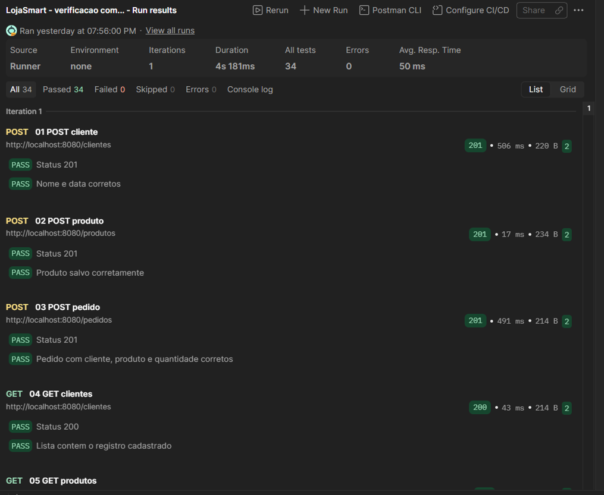
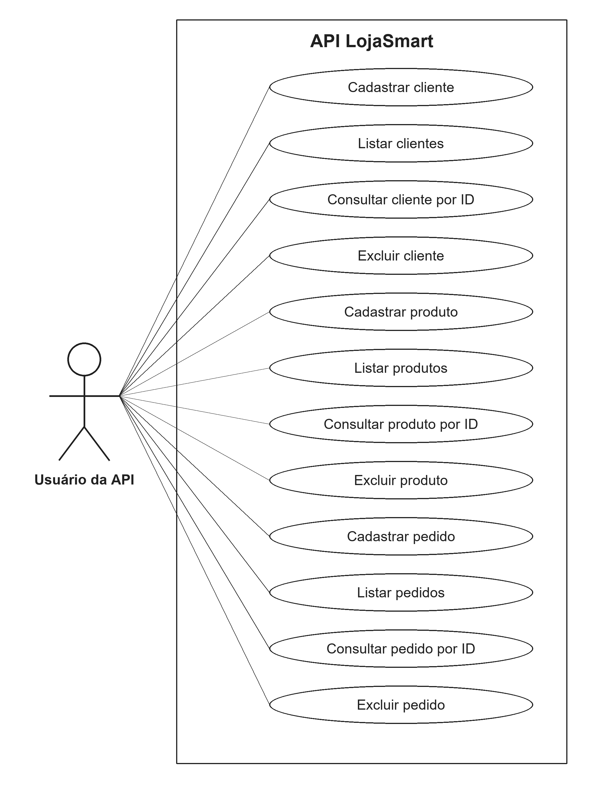

# LojaSmart

API REST acadêmica para uma pequena loja de celulares, desenvolvida para a atividade prática de Desenvolvimento Web Back-End. Gerencia clientes, produtos e pedidos com Java 17, Spring Boot, Spring Data JPA e banco relacional H2.

## Executar no Eclipse

1. Instale/configure um JDK 17 e selecione-o em **Java > Installed JREs**.
2. Baixe ou clone este repositório.
3. Importe por **File > Import > Maven > Existing Maven Projects**, selecionando a pasta que contém `pom.xml`.
4. Aguarde o download das dependências Maven. É necessário acesso à internet na primeira configuração.
5. Execute `LojasmartApplication.java` como **Java Application**.
6. Aguarde a mensagem de inicialização do Tomcat na porta 8080. Mantenha a aplicação em execução enquanto utiliza o Postman.

Endereço base: `http://localhost:8080`.

Também é possível iniciar pela raiz do projeto com o Maven Wrapper e `JAVA_HOME` apontando para o JDK 17:

```powershell
.\mvnw.cmd spring-boot:run
```

Em Linux/macOS:

```sh
sh mvnw spring-boot:run
```

## Banco de dados

O H2 utiliza a URL `jdbc:h2:file:./data/lojasmart-trabalho;DB_CLOSE_ON_EXIT=FALSE`, usuário `sa` e senha vazia para execução local. O Hibernate utiliza `ddl-auto=update`. O banco é criado na primeira execução e os dados persistem em arquivo. Os arquivos locais do banco não fazem parte do repositório.

O console H2 está disponível em `http://localhost:8080/h2-console` enquanto a aplicação estiver rodando. Utilize a URL JDBC configurada em `src/main/resources/application.properties`.

## Organização

```text
src/main/java/br/com/faculdade/lojasmart/
  LojasmartApplication.java
  model/        Entidades JPA
  repository/   Interfaces Spring Data JPA
  controller/   Endpoints e validações
src/main/resources/application.properties
postman/        Coleção de testes
docs/           Diagrama de casos de uso e evidência da execução
```

## Entidades

| Entidade | Campos |
|---|---|
| Cliente | id (Long), nome (String), clienteDesde (LocalDate) |
| Produto | id (Long), nome (String), preco (BigDecimal), estoque (Boolean) |
| Pedido | id (Long), clienteId (Long), produtoId (Long), quantidade (Integer) |

Os IDs são gerados automaticamente. Cada pedido registra um único produto e sua quantidade. Cliente e produto são referenciados pelos IDs, cuja existência é verificada antes do cadastro do pedido. O campo `estoque` representa disponibilidade, sem baixa automática de unidades. A implementação não declara relacionamentos JPA nem restrições de chave estrangeira para esses IDs; exclua os pedidos de teste antes dos produtos e clientes associados.

## Endpoints

| Método | Clientes | Produtos | Pedidos | Sucesso |
|---|---|---|---|---|
| POST | /clientes | /produtos | /pedidos | 201 |
| GET | /clientes | /produtos | /pedidos | 200 |
| GET | /clientes/{id} | /produtos/{id} | /pedidos/{id} | 200 |
| DELETE | /clientes/{id} | /produtos/{id} | /pedidos/{id} | 204 |

Consultas e exclusões de IDs inexistentes retornam 404. Os cenários inválidos tratados pelos controladores retornam 400. PUT não foi implementado, pois é opcional na atividade.

## Exemplo de uso

No Postman, selecione **Body > raw > JSON** nos POSTs. Crie cliente e produto antes de registrar o pedido.

`POST /clientes`

```json
{"nome":"Riann5015630","clienteDesde":"2026-11-10"}
```

`POST /produtos`

```json
{"nome":"Smartphone Alpha 128 GB","preco":1499.90,"estoque":true}
```

`POST /pedidos` (substitua os IDs pelos valores retornados nos dois cadastros):

```json
{"clienteId":1,"produtoId":1,"quantidade":2}
```

Cliente requer nome não vazio e data informada. Produto requer nome não vazio, preço positivo e disponibilidade informada. Pedido requer cliente e produto existentes e quantidade maior ou igual a 1.

## Testes no Postman

1. Inicie a API.
2. Importe `postman/LojaSmart.postman_collection.json` no Postman.
3. Execute a coleção completa, na ordem numérica, com uma iteração.

A coleção cria registros próprios para teste, verifica as respostas e exclui esses registros. Ao final, cria um cliente, um produto e um pedido demonstrativos. Cada nova execução acrescenta novos registros demonstrativos.

Em **11/11/2026**, foram executadas **25 requisições com 34 verificações aprovadas, nenhuma falha e nenhum erro no executor**. A execução abrangeu cadastro, listagem, consulta por ID, exclusão, consulta após exclusão e entradas inválidas. Esses resultados se referem à execução registrada no Postman; não representam execução de toda a suíte Maven.



## Diagrama de casos de uso


